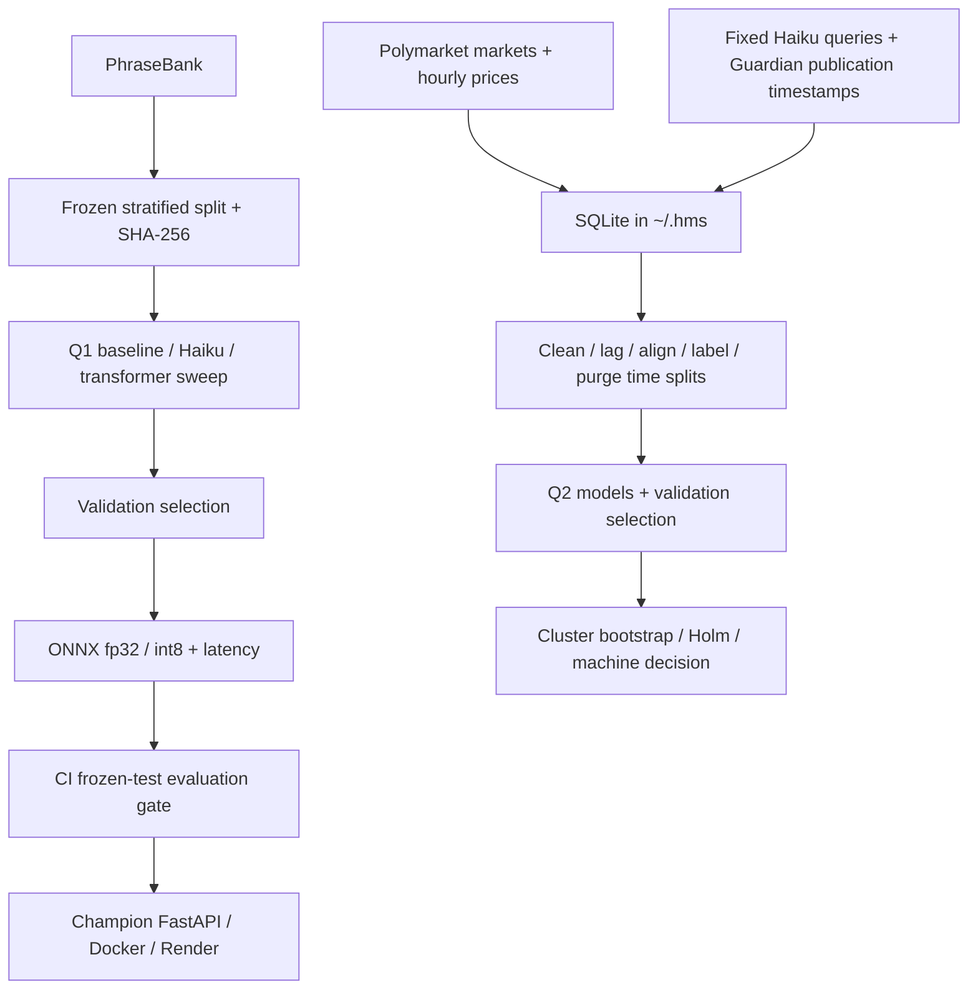

# Headline market signal

Two pre-registered questions: does a small financial sentiment classifier match a zero-shot LLM at lower cost and latency (Q1), and does a scored headline predict the next six-hour direction of a Polymarket YES price (Q2)?

The frozen protocol and amendments A1–A2 are in [PREREGISTRATION.md](PREREGISTRATION.md). All thresholds, metrics and splits remain frozen. See [docs/STATUS.md](docs/STATUS.md) for operational limitations.

## Data

Q1: Financial PhraseBank `Sentences_66Agree`, 4217 original sentences; 6 exact duplicates removed; 4211 unique sentences. Stratified seed-42 train / validation / frozen test: 2947 / 632 / 632. Test label counts: `{"negative": 77, "neutral": 380, "positive": 175}`. Frozen test SHA-256: `8e100c399e1f11b98bb3b157c1f0c53d2a4202e94feead897edb5a0677951486`.

Q2 uses the Guardian Open Platform Content API under amendment A2. The SQLite database lives at `~/.hms/hms.sqlite` (override with `HMS_DB`), outside the cloud-synced repository. Snapshot: 179 candidate markets, 150 selected, 329636 hourly price records, 150 fixed queries, 86783 raw Guardian headlines, 86457 cleaned headlines and 86457 alignment records. Guardian collection completed for all 150 markets, with three split-period requests each. The 847 previously collected GDELT headlines are archived separately and excluded.

| Split | Down | Flat | Up | Total |
|---|---|---|---|---|
| Train | 927 | 27505 | 860 | 29292 |
| Validation | 590 | 24723 | 639 | 25952 |
| Frozen test | 567 | 22613 | 534 | 23714 |

A further 6853 records have no usable price pair, 474 are purged at split boundaries and 172 are outside the event window. Counts describe coverage; Q2 results and interpretation are pending Claude's report.

Markets are binary, non-sports/non-esports, excluding short-horizon crypto price questions, with at least seven days of history, ranked by lifetime volume. The event window is 2026-08-01 through 2026-10-29 UTC.

## Method

Q1 compares TF-IDF word 1–2-grams plus logistic regression, Claude Haiku 5.5 zero-shot, and DistilRoBERTa-base selected by validation macro-F1 over the four pre-registered settings. The first completed setting used batch 16; subsequent settings use batch 8 and gradient checkpointing after a memory crash. Only one training process runs at once; macOS requires at least 20% memory_pressure free. Haiku uses effort low. The selected classifier is exported to ONNX fp32 and dynamic int8; int8 is accepted only if its macro-F1 drop is at most 0.01.

Q2 uses English Guardian publication timestamps (`webPublicationDate`, UTC, second precision), with the unchanged stored query per market and at most 200 relevance-ranked articles per split period. This gives single-publisher, English/UK-leaning coverage. The collector filters to August 1 through October 29, 2026 UTC. Cleaning drops titles under five words and deduplicates normalized titles within a market for 24 hours. Event time is publication time plus 15 minutes. The last price at or before event time and six hours later must each be within the preceding two hours. A move >=0.005 is up, <=-0.005 down, otherwise flat; flats are reported and excluded from directional metrics. Train ends September 21, validation ends October 8, and frozen test covers October 9–29. Label windows crossing splits are purged.

Q2 compares the same three model families. Amendment A1 permits two fine-tuning settings (2e-5 and 5e-5, two epochs); selection uses validation AUC. Sweep runs score development data only, save checkpoints, freeze selection on disk, and then score the test set. The baseline and selected transformer also have headline-only ablations. Primary AUC intervals use 2,000 market-cluster bootstrap resamples, with Holm correction over the three primary models. Secondary metrics are directional hit rate, ECE, and Spearman correlation with price moves including flats.

## Q1 results

Values below are copied from [results/q1/results.json](results/q1/results.json) using the JSON numbers' full recorded precision. Local model dollar cost denotes API charges only; hardware, electricity and training time are excluded.

| Model | Accuracy | Macro-F1 | ECE | USD / 1,000 | Seconds / 1,000 |
|---|---|---|---|---|---|
| TF-IDF + LR (CPU) | 0.7990506329113924 | 0.7228421270812104 | 0.02478278578963277 | 0.0 | 0.01711267087338905 |
| Haiku 5.5 (8 concurrent requests) | 0.8939873417721519 | 0.8841500106898508 | 0.07439873417721518 | 0.023656455696202533 | 139.81202979902022 |
| DistilRoBERTa (torch CPU) | 0.884493670886076 | 0.8681710547803233 | 0.048722888802803024 | 0.0 | 7.914835640838623 |

Selected setting: `lr2e-05_ep2`.

| ONNX CPU, batch 32 | Macro-F1 | Seconds / 1,000 | Size MB |
|---|---|---|---|
| onnx_fp32 | 0.8681710547803233 | 104.0395991566342 | 328.6 |
| onnx_int8 | 0.8705732764219003 | 23.135549248418332 | 82.5 |

Paired bootstrap fine-tuned minus zero-shot macro-F1: -0.01597895590952747, 95% CI [-0.05090642715214274, 0.01891372335620403], 2000 resamples.

Q1 report decision, verbatim: `fine-tuned matches zero-shot (CI includes 0)`.

Full deviations and calibration: [Q1 report](results/q1/results.md).

## Q2 results

| Model | AUC [95% market-cluster CI] | one-sided p | hit rate | ECE | Spearman ρ with Δp |
|---|---|---|---|---|---|
| TF-IDF + LR (question + headline) | 0.490 [0.435, 0.576] | 0.571 | 0.492 | 0.107 | -0.003 |
| Claude Haiku 5.5 zero-shot (question + headline) | 0.513 [0.476, 0.545] | 0.227 | 0.521 | 0.010 | -0.009 |
| DistilRoBERTa fine-tuned (question + headline) | 0.485 [0.423, 0.565] | 0.666 | 0.515 | 0.019 | +0.009 |
| Ablation: TF-IDF + LR, headline only | 0.520 [0.486, 0.556] | 0.118 | 0.523 | 0.035 | +0.005 |
| Ablation: DistilRoBERTa, headline only | 0.510 [0.471, 0.544] | 0.303 | 0.515 | 0.009 | +0.008 |
| Naive: always majority / random | 0.500 | – | 0.515 / 0.500 | – | – |

Test set: 1101 non-flat events (|Δp| ≥ 0.5¢ over 6 h) in 36 markets, Oct 9–29 2026; up share 0.485. Holm–Bonferroni: no model survives.

Pre-registered decision string, verbatim from Claude's Q2 report:

**INCONCLUSIVE** (pre-registered rule). No model's AUC is distinguishable from 0.5 and none survives Holm correction, but it is not a REJECT: the baseline and fine-tuned CIs reach above the pre-registered 0.56 bound because only 36 test markets moved. Plain reading: no evidence that headlines predict the next 6 h of Polymarket prices; a small effect cannot be ruled out for two of three models.

## What did not work

The original Q1 batch-16 sweep exhausted this 8 GB Mac's memory during the next setting. Amendment A1 records batch 8 and gradient checkpointing. The completed first checkpoint was revalidated against its exact stored validation macro-F1 after an MLflow export failure mislabeled the run FAILED; it was not retrained.

GDELT DOC API throttled collection with HTTP 429: only 5 of 450 query windows completed in 2.5 hours. Amendment A2 replaced it with the Guardian API before any Q2 labels were computed, keeping queries, lag, cleaning, thresholds and splits unchanged. Google News RSS was rejected because date-only timestamps can leak the price move into the label. SQLite was moved out of the cloud-synced repository to `~/.hms` after database corruption.

## Run

Python 3.12. Install the research environment; keep keys in the ignored `.env` or environment (`ANTHROPIC_API_KEY`, `GUARDIAN_API_KEY`):

```bash
uv venv --python 3.12 .venv
uv pip install --python .venv -r requirements-train.txt
```

For a fresh reproduction, the data and Q1 entrypoints are:

```bash
scripts/run_pipeline.sh        # markets → queries → Guardian → alignment
scripts/q1_run.sh              # Q1 sweep → selection → ONNX → report
```

The current database is already built. Continue Q2 from it without rerunning collection or alignment. Fine-tuning runs sequentially, with batch 8, gradient checkpointing and a memory-pressure guard. Q2 commands in order:

```bash
export PYTHONPATH=src TOKENIZERS_PARALLELISM=false
.venv/bin/python -m hms.q2 baseline
.venv/bin/python -m hms.q2 haiku
.venv/bin/python -m hms.q2_finetune --run lr2e-05_ep2
.venv/bin/python -m hms.q2_finetune --run lr5e-05_ep2
.venv/bin/python -m hms.q2_finetune --select
# Use the selected setting from data/q2_scores/ft_runs/selection.json:
.venv/bin/python -m hms.q2_finetune --run <selected> --headline-only
.venv/bin/python -m hms.q2_finetune --select
.venv/bin/python -m hms.q2 report
```

In the current work split, Claude owns baseline/Haiku scoring, the Q2 report, calibration and interpretation; Codex owns fine-tuning and the README draft. Existing baseline and Haiku stages must finish without being restarted. Selection is frozen before transformer test scoring; test-score files are left for Claude. The older `scripts/q2_run.sh` still checks GDELT collection and should not be used with the Guardian database.



## Serving and CI

`serve.app:app` loads `MODEL_DIR` (default `artifacts/champion`) once at startup. `GET /health` reports the model version; `POST /predict` accepts 1–256 texts of at most 1,000 characters. Inference uses tokenizers and ONNX Runtime int8, max length 128, dynamic padding and batch 32. The non-root Docker image downloads the champion from the public Hugging Face model repo [`Ibra-049/headline-sentiment`](https://huggingface.co/Ibra-049/headline-sentiment) at build time and listens on `$PORT` (7860 locally).

```bash
docker build -t headline-sentiment-api . && docker run -p 7860:7860 headline-sentiment-api
curl -X POST localhost:7860/predict -H 'content-type: application/json' \
  -d '{"texts":["Profit rose 40% and the company raised guidance"]}'
```

**Model versioning.** The HF model repo holds the `candidate` branch and `main` (= champion, tagged `v1.0.0`, ...).

**CI.** Every push and pull request runs Ruff and pytest (96 tests). On `main`, the eval-gate workflow downloads the HF `candidate` and `main` revisions, checks the frozen Q1 test file against its recorded SHA-256, and scores both candidate and champion on the same runner (int8 kernels differ across CPUs: the same model scored 0.872 on one GitHub runner and 0.881 on another, so a stored score is not comparable). An identical model is never promoted; otherwise the candidate is promoted only if its macro-F1 beats the champion's by at least 0.005 (pre-registered), or if no champion exists; the promotion is committed to HF `main` and version-tagged. The first run promoted v1.0.0.

**Deploy.** `render.yaml` defines a free-tier Render web service built from the Dockerfile (free instances sleep when idle, so the first request after a pause is slow). After a promotion the eval gate calls the Render deploy hook (`RENDER_DEPLOY_HOOK` secret) so the API rebuilds with the new champion; without the secret the step only logs a notice. Hugging Face Docker Spaces were the first target but need a paid plan, so they were dropped.

```bash
.venv/bin/ruff check .
.venv/bin/python -m pytest -q
.venv/bin/python scripts/eval_gate.py --candidate artifacts/candidate \
  --champion artifacts/champion --test data/frozen/q1_test.csv --min-delta 0.005
```

## Cost and licences

Q1 Haiku's recorded API cost is $0.023656455696202533 per 1,000 headlines, as shown in the Q1 table. Local model API cost is $0/1,000; hardware, electricity and training time are excluded. Total Anthropic spend is pending completion of Claude's Q2 work. The existing spend guard stops at the $5 budget and cache hits incur no new API charge.

Financial PhraseBank: [CC BY-NC-SA 3.0, author dataset card](https://huggingface.co/datasets/takala/financial_phrasebank); non-commercial use with attribution and share-alike conditions. Polymarket data remains subject to [Polymarket Terms of Use](https://polymarket.com/tos), including data-access and redistribution restrictions. Guardian headlines are subject to the [Guardian Open Platform terms](https://www.theguardian.com/open-platform/terms-and-conditions); this project does not grant redistribution rights. Archived data from the GDELT Project ([GDELT terms](https://www.gdeltproject.org/about.html#termsofuse)); attribution does not transfer publisher copyrights in linked news. No new licence is granted over third-party data or model weights.

**No profit claims.** This is research, not a trading strategy. No fees, spreads, slippage, execution or capacity are modeled. All negative results are kept. A PROMOTE status would authorize only a fresh forward test.
