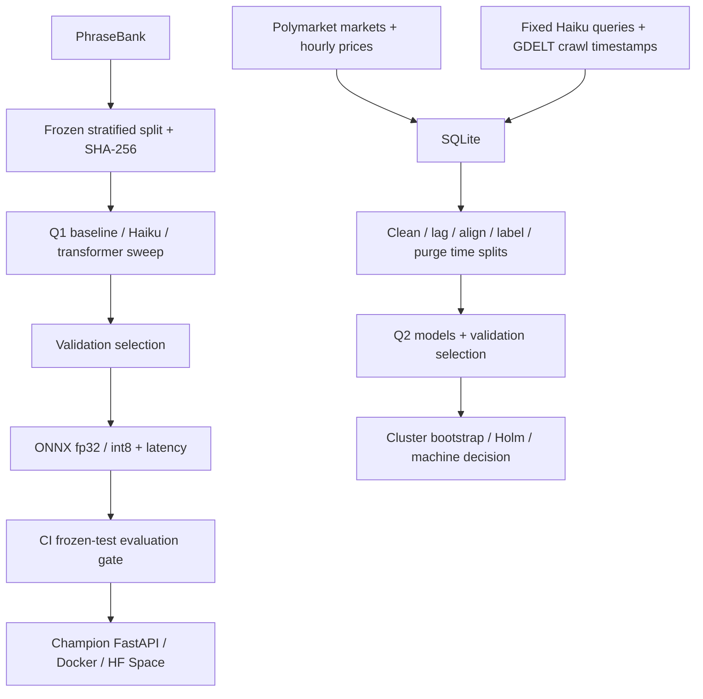

# Headline market signal

Two pre-registered questions: does a small financial sentiment classifier match a zero-shot LLM at lower cost and latency (Q1), and does a scored headline predict the next six-hour direction of a Polymarket YES price (Q2)?

The frozen protocol and amendment A1 are in [PREREGISTRATION.md](PREREGISTRATION.md). All thresholds, metrics and splits remain frozen. See [docs/STATUS.md](docs/STATUS.md) for operational limitations.

## Data

Q1: Financial PhraseBank `Sentences_66Agree`, 4217 original sentences; 6 exact duplicates removed; 4211 unique sentences. Stratified seed-42 train / validation / frozen test: 2947 / 632 / 632. Test label counts: `{"negative": 77, "neutral": 380, "positive": 175}`. Frozen test SHA-256: `8e100c399e1f11b98bb3b157c1f0c53d2a4202e94feead897edb5a0677951486`.

Q2 DB snapshot: 179 candidate markets, 150 selected, 329636 hourly price records, 150 fixed queries, 0 raw headlines, 0 cleaned headlines, 0 aligned events. Collection: 0/450 monthly windows complete. These are collected counts, not evidence of a market signal.

Markets are binary, non-sports/non-esports, excluding short-horizon crypto price questions, with at least seven days of history, ranked by lifetime volume. The event window is 2026-08-01 through 2026-10-29 UTC.

## Method

Q1 compares TF-IDF word 1–2-grams plus logistic regression, Claude Haiku 5.5 zero-shot, and DistilRoBERTa-base selected by validation macro-F1 over the four pre-registered settings. The first completed setting used batch 16; subsequent settings use batch 8 and gradient checkpointing after a memory crash. Only one training process runs at once; macOS requires at least 20% memory_pressure free. Haiku uses effort low. The selected classifier is exported to ONNX fp32 and dynamic int8; int8 is accepted only if its macro-F1 drop is at most 0.01.

Q2 uses English GDELT crawl timestamps, rejects any article outside its requested half-open collection window, drops titles under five words, and deduplicates normalized titles within a market for 24 hours. Event time is crawl time plus 15 minutes. The last price at or before event time and six hours later must each be less than two hours old. A move >=0.005 is up, <=-0.005 down, otherwise flat; flats are reported and excluded from directional metrics. Train ends September 21, validation ends October 8, and frozen test covers October 9–29. Label windows crossing splits are purged.

Q2 compares the same three model families. Amendment A1 permits two fine-tuning settings (2e-5 and 5e-5, two epochs); selection uses validation AUC. Sweep runs score development data only, save checkpoints, freeze selection on disk, and then score the test set. The baseline and selected transformer also have headline-only ablations. Primary AUC intervals use 2,000 market-cluster bootstrap resamples, with Holm correction over the three primary models. Secondary metrics are directional hit rate, ECE, and Spearman correlation with price moves including flats.

## Q1 results

Values below are copied from [results/q1/results.json](results/q1/results.json) using the JSON numbers' full recorded precision. Local model dollar cost denotes API charges only; hardware, electricity and training time are excluded.

| Model | Accuracy | Macro-F1 | ECE | USD / 1,000 | Seconds / 1,000 |
|---|---|---|---|---|---|
| TF-IDF + LR (CPU) | 0.7990506329113924 | 0.7228421270812104 | 0.02478278578963277 | 0.0 | 0.01711267087338905 |
| Haiku 5.5 (8 concurrent requests) | 0.8939873417721519 | 0.8841500106898508 | 0.07439873417721518 | 0.023656455696202533 | 139.81202979902022 |
| DistilRoBERTa (torch CPU) | 0.884493670886076 | 0.8681710547803233 | 0.048722888802803024 | 0.0 | 7.914835640838623 |

Selected setting: `lr2e-05_ep2`.

| ONNX CPU, batch 32 | Macro-F1 | Seconds / 1,000 | Size MB |
|---|---|---|---|
| onnx_fp32 | 0.8681710547803233 | 104.0395991566342 | 328.6 |
| onnx_int8 | 0.8705732764219003 | 23.135549248418332 | 82.5 |

Paired bootstrap fine-tuned minus zero-shot macro-F1: -0.01597895590952747, 95% CI [-0.05090642715214274, 0.01891372335620403], 2000 resamples.

Q1 report decision, verbatim: `fine-tuned matches zero-shot (CI includes 0)`.

Full deviations and calibration: [Q1 report](results/q1/results.md).

## Q2 results

Pending collection; no Q2 decision or model AUCs have been computed.

## What did not work

The original Q1 batch-16 sweep exhausted this 8 GB Mac's memory during the next setting. Amendment A1 records batch 8 and gradient checkpointing. The completed first checkpoint was revalidated against its exact stored validation macro-F1 after an MLflow export failure mislabeled the run FAILED; it was not retrained.

GDELT DOC API frequently returns HTTP 429 from this IP. Collection uses at least 30 seconds between requests, 2/4/8-minute capped backoff, at most six attempts per fetch, and logs every attempt. A resumable three-hour probe stops collection if fewer than 20% of the 450 windows are complete. Empty/invalid responses and saturated ten-day subwindows are not counted as complete. Partial collection does not authorize Q2 training. Google News RSS was rejected because its date-only timestamps can leak the price move into the label. No substitute source has been introduced.

## Run

Python 3.12. Install the research environment and keep secrets in the ignored `.env` or environment variables:

```bash
uv venv --python 3.12 .venv
uv pip install --python .venv -r requirements-train.txt
scripts/q1_run.sh              # Q1, resumes completed training settings
scripts/run_pipeline.sh        # markets → queries → GDELT → alignment
scripts/q2_run.sh              # requires all 450 collection windows complete
```

Individual Q2 stages, in order:

```bash
export PYTHONPATH=src TOKENIZERS_PARALLELISM=false
.venv/bin/python -m hms.build
.venv/bin/python -m hms.q2 baseline
.venv/bin/python -m hms.q2 haiku
.venv/bin/python -m hms.q2_finetune --run lr2e-05_ep2
.venv/bin/python -m hms.q2_finetune --run lr5e-05_ep2
.venv/bin/python -m hms.q2_finetune --select
# Read selected from data/q2_scores/ft_runs/selection.json:
.venv/bin/python -m hms.q2_finetune --run <selected> --headline-only
.venv/bin/python -m hms.q2_finetune --select
.venv/bin/python -m hms.q2 report
```

Run the collector unattended with output preserved:

```bash
PYTHONPATH=src nohup .venv/bin/python -u -m hms.gdelt > data/gdelt.log 2>&1 &
tail -f data/gdelt.log
```

Probe state is in `data/collection_progress.json`. A restart retains the original probe start and completed windows. Exit 3 means the three-hour probe failed; owner + Claude must decide on a timestamped alternative before any affected labels or scores are computed. Do not reset the probe to evade this rule.



## Serving and CI

`serve.app:app` loads `MODEL_DIR` (default `artifacts/champion`) once at startup. `GET /health` reports model version; `POST /predict` accepts 1–256 texts of at most 1,000 characters. Inference uses tokenizers and ONNX Runtime, max length 128, dynamic padding and batch 32. The non-root Docker image exposes port 7860.

Pull requests and pushes run Ruff and pytest. On main, the eval-gate workflow downloads HF `candidate` and `main` revisions, verifies the frozen test hash, and measures candidate macro-F1. The frozen protocol requires an improvement of at least 0.005 over champion metadata (or no existing champion). The older MLOps brief described a strict boundary; implementation now follows the authoritative pre-registration's inclusive boundary. A passing candidate is committed and version-tagged in HF, then deployed to the Docker Space. Configure `HF_TOKEN`, `HF_MODEL_REPO`, and `HF_SPACE_REPO`; missing token skips remote evaluation/deployment. This local task does not push or deploy.

```bash
.venv/bin/ruff check .
.venv/bin/python -m pytest -q
.venv/bin/python scripts/eval_gate.py --candidate artifacts/candidate \
  --champion artifacts/champion --test data/frozen/q1_test.csv --min-delta 0.005
```

## Cost and licences

Recorded Anthropic spend: $0.022782679999999975 USD, calculated from cached token usage and the study's recorded rates ($0.10/M input, $0.50/M output, $0.01/M cache read, $0.125/M cache write). This is an estimate from stored usage, not an account invoice. Rates were checked against [Anthropic's Haiku 5.5 pricing](https://www.anthropic.com/claude-haiku-5-5) on 2026-10-30. Local model API cost is $0/1,000; it excludes hardware and electricity. Calls reserve budget for concurrent requests and stop before the recorded total can exceed $5. Cache hits incur no new API charge.

Financial PhraseBank: [CC BY-NC-SA 3.0, author dataset card](https://huggingface.co/datasets/takala/financial_phrasebank); non-commercial use with attribution and share-alike conditions. Polymarket data remains subject to [Polymarket Terms of Use](https://polymarket.com/tos), including data-access and redistribution restrictions. Data from the GDELT Project ([GDELT terms](https://www.gdeltproject.org/about.html#termsofuse)); attribution does not transfer publisher copyrights in linked news. No new licence is granted over third-party data or model weights.

**No profit claims.** This is research, not a trading strategy. No fees, spreads, slippage, execution or capacity are modeled. All negative results are kept. A PROMOTE status would authorize only a fresh forward test.
