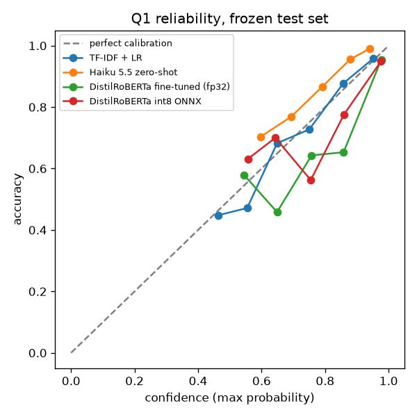

# Q1 results — Financial PhraseBank (66% agree), frozen test set

Train / val / test: 2947 / 632 / 632 sentences. Test SHA-256 `8e100c399e1f11b98bb3b157c1f0c53d2a4202e94feead897edb5a0677951486`.

| Model | Accuracy | Macro-F1 | ECE | Cost / 1k (USD) | Latency / 1k (s) |
|---|---|---|---|---|---|
| TF-IDF + LR | 0.799 | 0.723 | 0.025 | 0.0000 | 0.017 (CPU) |
| Haiku 5.5 zero-shot | 0.894 | 0.884 | 0.074 | 0.0237 | 139.8 (8 parallel requests) |
| DistilRoBERTa fine-tuned (fp32, torch) | 0.884 | 0.868 | 0.049 | 0.0000 | 7.53 (MPS) / 7.91 (CPU) |
| DistilRoBERTa ONNX fp32 | 0.884 | 0.868 | 0.049 | 0.0000 | 104.04 (CPU) |
| DistilRoBERTa ONNX int8 | 0.894 | 0.871 | 0.044 | 0.0000 | 23.14 (CPU) |

Sweep (selected on validation macro-F1):

| Run | LR | Epochs | Val macro-F1 |
|---|---|---|---|
| lr2e-05_ep2 | 2e-05 | 2 | 0.9054 |
| lr2e-05_ep3 | 2e-05 | 3 | 0.8962 |
| lr5e-05_ep2 | 5e-05 | 2 | 0.8764 |
| lr5e-05_ep3 | 5e-05 | 3 | 0.8749 |

Selected: `lr2e-05_ep2`.

Quantization: int8 macro-F1 drop vs fp32 ONNX = -0.0024 (accepted if ≤ 0.01: True). Size 328.6 MB → 82.5 MB.

Paired bootstrap, 2,000 resamples, 95% CI of the macro-F1 difference:

| Comparison | Point | 95% CI |
|---|---|---|
| finetuned_distilroberta_minus_zeroshot_haiku | -0.0160 | [-0.0509, +0.0189] |
| onnx_int8_minus_zeroshot_haiku | -0.0136 | [-0.0498, +0.0247] |
| baseline_tfidf_lr_minus_zeroshot_haiku | -0.1613 | [-0.2118, -0.1144] |
| finetuned_distilroberta_minus_baseline_tfidf_lr | +0.1453 | [+0.1012, +0.1935] |

**Pre-registered verdict:** fine-tuned matches zero-shot (CI includes 0).

## Deviations from the pre-registration

- 6 exact duplicate sentences were dropped before splitting (4,217 → 4,211), so the same sentence cannot be in both train and test.
- Sweep run 1 (`lr2e-05_ep2`) completed with batch 16. An initial attempt at run 2 exhausted the 8 GB machine's memory, so runs 2–4 used batch 8 with gradient checkpointing (and eager attention, which MPS needs for it), one process per run. max_len stayed 128 and the lr × epochs grid did not change. Batch size is not fixed in the pre-registration.
- Run 1's saved checkpoint reproduced its recorded validation macro-F1 exactly (0.9053783347607478). Its MLflow status was repaired from FAILED to FINISHED: training had completed; the failure occurred after test metrics were logged during model export. No additional sweep run was trained. Results are now saved before optional registry work, which uses a separate export run.
- Haiku zero-shot settings, not specified in the pre-registration: thinking disabled, effort low. Its probabilities put the stated confidence on its label and split the rest evenly over the other two labels; this affects ECE only.

